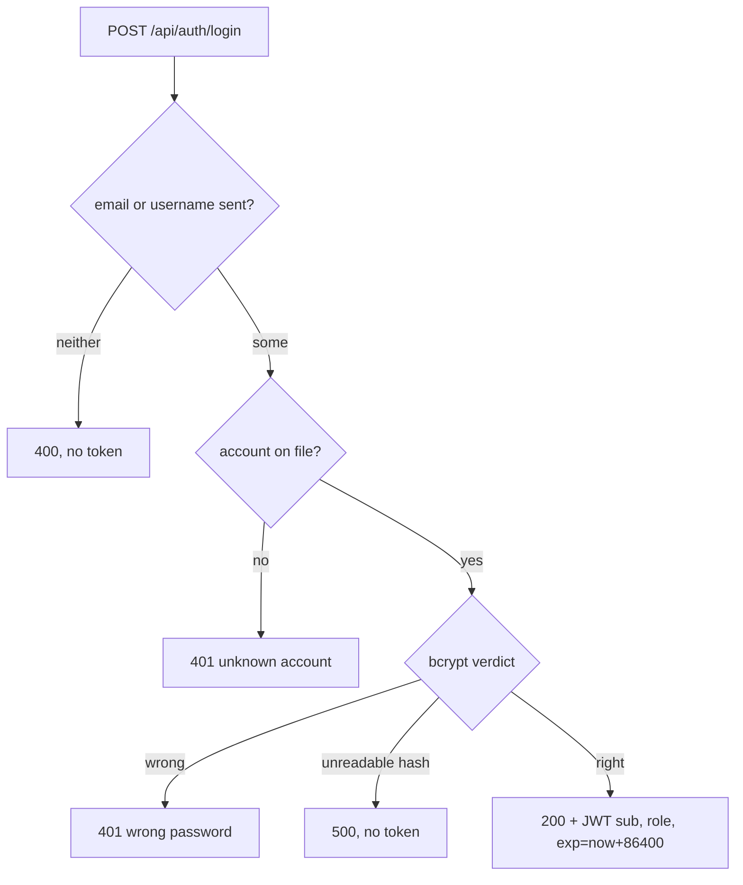

# Intent map (example) — login behaviour, test-land edition

Generated by the plan phase (B6). Mermaid, in-repo, reviewable without
reading the implementation. Structure mirrors PDD Kit's rough-work section:
flowchart → spec landscape → intent map entries.

## Flowchart — every way the login can end

## Spec landscape

| Component | Status | Where |
|---|---|---|
| decision core (`decide_login`) | **checked** — pure fn, property-tested both ways | `core/decide.py` |
| expiry arithmetic | **checked** — property: exp == now + 86400 | `core/expiry.py` |
| password verdict (bcrypt) | **trusted** — contract + pinning test | `wrappers/pw.py`, `tests/test_boundary.py::test_pw_verdict` |
| account lookup (DB) | **trusted** — contract + pinning test | `wrappers/db.py` |
| token signing (JWT) | **trusted** — contract: signs exactly the claims given | `wrappers/jwt.py` |
| clock | **trusted** — contract: expiry is exactly now + 86400 | `wrappers/clock.py` |

## Intent map entries

| # | Your words | Decision | Models it (spec §) | Covered by | Killed by |
|---|---|---|---|---|---|
| B1 | "You only get a token with the right password" — **and always with it** (decided 2026-11-07, iff) | card D1: both directions required | §2.1 (token ⇔ verdict ∧ on-file) | `test_login.py::test_token_iff_password` (property, 200 cases) | mutmut #14 `!=`→`==` in decide.py |
| B2 | "Only admin accounts get admin tokens" | email field picks the window; username never promotes | §2.2 | `test_login.py::test_email_wins_over_username` | Stryker #87 role branch |
| B3 | refusals: 400 / 401 / 401 / 500 | table agreed before code | §2.3 | `test_refusals.py` (4 cases) | mutmut #3 status code |
| B4 | token expiry: 24 hours | exact, not "about a day" | §2.4 | `test_expiry.py::test_exactly_24h` | mutmut #22 `86400`→`86401` |

*An entry with an empty "Killed by" cell blocks the PR (B1 of the rig intent).
An adjudicated survivor links its `adjudications.md` line instead of a mutant
ID — and "vacuous" sends the entry back to re-approval.*
